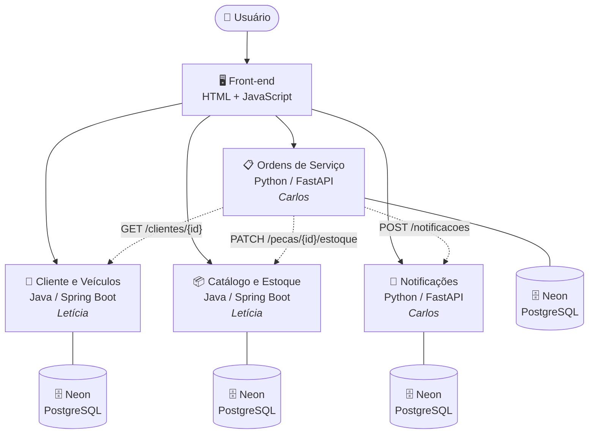

# 🔧 Mecânico: Sistema de Oficina em Microsserviços

Trabalho 4 de Arquitetura de Sistemas: uma oficina mecânica dividida em **quatro microsserviços** independentes (Python e Java), cada um com o **seu próprio banco de dados**, conectados por um **front-end** em HTML e JavaScript e publicados na **nuvem**.

[](https://oficina-frontend-sc9n.onrender.com)


---

## 👥 Equipe

| Integrante | GitHub | Linguagem | Microsserviços |
|---|---|---|---|
| **Carlos Eduardo Fernandes Ribeiro Rodrigues** | [@CarlosEduardo572](https://github.com/CarlosEduardo572) | Python (FastAPI) | Ordens de Serviço · Notificações |
| **Letícia Fermanian** | [@Fermanian21](https://github.com/Fermanian21) | Java (Spring Boot) | Cliente e Veículos · Catálogo e Estoque |

---

## 🌐 Aplicação na nuvem

| Componente | Link |
|---|---|
| 🖥️ **Front-end** | https://oficina-frontend-sc9n.onrender.com |
| 📋 Ordens de Serviço | https://servico-os.onrender.com/ordens |
| 🔔 Notificações | https://notificacoes-5vhb.onrender.com/notificacoes |
| 👤 Cliente e Veículos | https://clientes-veiculos.onrender.com/clientes |
| 📦 Catálogo e Estoque | https://catalogo-estoque.onrender.com/pecas |

> ⏳ **Aviso:** no plano gratuito da Render os serviços "dormem" após cerca de 15 minutos sem uso. O primeiro acesso pode levar cerca de 1 minuto (os serviços Java demoram um pouco mais). Abra as URLs acima antes de testar.

---

## 🏗️ Arquitetura



As setas tracejadas mostram a comunicação **entre microsserviços**: o serviço de Ordens de Serviço atua como **consumidor** dos serviços de Clientes, Catálogo e Notificações. Toda a troca de dados é feita por **HTTP + JSON**.

---

## 📁 Estrutura do repositório

```
Mecanico/
├── servico-os/          # 📋 Ordens de Serviço       (Python / FastAPI)  - Carlos
├── notificacoes/        # 🔔 Notificações            (Python / FastAPI)  - Carlos
├── clientes-veiculos/   # 👤 Cliente e Veículos      (Java / Spring)     - Letícia
├── catalogo-estoque/    # 📦 Catálogo e Estoque      (Java / Spring)     - Letícia
├── frontend/            # 🖥️ Página única que conecta os quatro serviços
└── legado-trabalho3/    # 🗂️ Código do trabalho anterior (monolito, mantido como histórico)
```

---

## 📋 Serviço de Ordens de Serviço (`servico-os`)

> 🐍 Desenvolvido por **Carlos**

Cuida do ciclo de vida de uma ordem de serviço. Antes de abrir uma ordem, **valida o cliente** no serviço de Clientes; ao usar uma peça, **baixa o estoque** no Catálogo; e a cada evento **envia uma notificação**.

| Método | Rota | Descrição |
|---|---|---|
| `GET` | `/ordens` | Lista as ordens (mais recentes primeiro) |
| `POST` | `/ordens` | Abre uma ordem (valida o cliente; `404` se não existir) |
| `PATCH` | `/ordens/{id}/status` | Altera apenas o status da ordem |
| `POST` | `/ordens/{id}/pecas` | Registra o uso de uma peça e baixa o estoque (`404`, `400` ou `503` em caso de falha) |

**Exemplo: abrir uma ordem**

```bash
curl -X POST https://servico-os.onrender.com/ordens \
  -H "Content-Type: application/json" \
  -d '{"cliente_id":1,"cliente_nome":"Maria Silva","placa_veiculo":"ABC1D23","descricao_servico":"Troca de óleo","valor":80}'
```

---

## 🔔 Serviço de Notificações (`notificacoes`)

> 🐍 Desenvolvido por **Carlos**

Guarda as mensagens geradas pelo serviço de Ordens (ordem aberta, status alterado, peça usada).

| Método | Rota | Descrição |
|---|---|---|
| `POST` | `/notificacoes` | Recebe e grava uma notificação |
| `GET` | `/notificacoes` | Lista as notificações (mais recentes primeiro) |

---

## 👤 Serviço de Cliente e Veículos (`clientes-veiculos`)

> ☕ Desenvolvido por **Letícia**

Cadastro dos clientes da oficina e dos veículos de cada cliente. É um **provedor**: o serviço de Ordens de Serviço consulta o cliente aqui antes de abrir uma ordem. Cada veículo pertence a um cliente (`cliente_id`).

| Método | Rota | Descrição |
|---|---|---|
| `POST` | `/clientes` | Cadastra um cliente |
| `GET` | `/clientes` | Lista os clientes |
| `GET` | `/clientes/{id}` | Consulta um cliente (`404` se não existir) |
| `PUT` | `/clientes/{id}` | Atualiza o cadastro (também usado para **inativar**, com `ativo: false`) |
| `POST` | `/clientes/{id}/veiculos` | Cadastra um veículo do cliente (`404` se o cliente não existir) |
| `GET` | `/clientes/{id}/veiculos` | Lista os veículos do cliente |
| `GET` | `/veiculos/{id}` | Consulta um veículo |

**Exemplo: cadastrar um cliente**

```bash
curl -X POST https://clientes-veiculos.onrender.com/clientes \
  -H "Content-Type: application/json" \
  -d '{"nome":"Maria Silva","cpf":"123.456.789-00","telefone":"85999990000","email":"maria@email.com"}'
```

---

## 📦 Serviço de Catálogo e Estoque (`catalogo-estoque`)

> ☕ Desenvolvido por **Letícia**

O que a oficina vende e consome: peças (com controle de estoque) e serviços. É um **provedor**: o serviço de Ordens de Serviço baixa o estoque aqui quando uma peça é usada.

| Método | Rota | Descrição |
|---|---|---|
| `POST` | `/pecas` | Cadastra uma peça |
| `GET` | `/pecas` | Lista as peças |
| `GET` | `/pecas/{id}` | Consulta uma peça |
| `PUT` | `/pecas/{id}` | Atualiza nome, código, preço, estoque mínimo e situação (**não altera a quantidade em estoque**) |
| `GET` | `/pecas/{id}/estoque` | Consulta a quantidade e se está abaixo do mínimo |
| `PATCH` | `/pecas/{id}/estoque` | Ajusta o estoque: `quantidade` negativa dá baixa, positiva repõe (`409` se o estoque for insuficiente) |
| `POST` | `/servicos` | Cadastra um serviço |
| `GET` | `/servicos` | Lista os serviços |
| `GET` | `/servicos/{id}` | Consulta um serviço |

**Exemplo: dar baixa de 2 unidades no estoque**

```bash
curl -X PATCH https://catalogo-estoque.onrender.com/pecas/1/estoque \
  -H "Content-Type: application/json" \
  -d '{"quantidade":-2}'
```

---

## 🧭 Decisões de projeto (rotas que não foram criadas)

**Ordens de Serviço e Notificações (Carlos)**

- **`DELETE /ordens/{id}`**: a ordem é um registro histórico e financeiro; o cancelamento é feito pelo status.
- **`GET /ordens/{id}` e `PUT /ordens/{id}`**: o front-end já recebe tudo na listagem e só altera o status.
- **`PUT` e `DELETE` em notificações**: são um registro do que foi enviado e não devem ser alterados.

**Cliente e Veículos e Catálogo e Estoque (Letícia)**

- **`DELETE` de cliente, peça e serviço**: eles aparecem em ordens antigas; o correto é **inativar** (`ativo = false`) para não perder o histórico.
- **`PUT /pecas/{id}` não mexe no estoque**: a quantidade só muda pelo `PATCH /pecas/{id}/estoque`, para que editar um preço não sobrescreva o estoque por engano.
- **Relatórios de estoque**: fora do escopo desta etapa.

**Para todos**

- **Autenticação**: fora do escopo desta etapa.

---

## 🚀 Como rodar localmente

Cada serviço sobe sozinho e, sem variáveis de ambiente, usa um banco local (SQLite no Python, H2 no Java).

| Serviço | Porta |
|---|---|
| Cliente e Veículos | `8080` |
| Catálogo e Estoque | `8081` |
| Ordens de Serviço | `8001` |
| Notificações | `8002` |

**Serviços Python** (um terminal para cada, no Windows):

```bat
cd servico-os
py -m venv .venv
.venv\Scripts\activate
pip install -r requirements.txt
uvicorn main:app --port 8001
```

Para as notificações, repita dentro de `notificacoes` com `--port 8002`.

**Serviços Java** (um terminal para cada):

```bash
cd clientes-veiculos
./mvnw spring-boot:run
```

Repita em `catalogo-estoque`. Depois, abra o arquivo `frontend/index.html` no navegador (as URLs no início do script apontam para a nuvem; troque por `http://localhost:PORTA` para testar localmente).

---

## ⚙️ Configuração por variáveis de ambiente

| Serviço | Variáveis |
|---|---|
| `servico-os` | `DATABASE_URL`, `CLIENTES_URL`, `CATALOGO_URL`, `NOTIFICACOES_URL` |
| `notificacoes` | `DATABASE_URL` |
| `clientes-veiculos` / `catalogo-estoque` | `DATABASE_URL`, `DATABASE_USER`, `DATABASE_PASSWORD` |

> 🔒 Os valores reais (principalmente as senhas dos bancos) ficam apenas no painel da Render e **nunca** são enviados ao repositório.

---

## ☁️ Implantação

- **Serviços:** Render (Web Services com Docker), cada um a partir do seu `Dockerfile`, na branch `main`.
- **Bancos:** um projeto PostgreSQL separado na Neon para cada serviço.
- **Front-end:** Render (Static Site), publicando a pasta `frontend`.
- A cada *merge* na `main`, a Render reimplanta automaticamente.

---

## 🗂️ Trabalhos anteriores

Diagramas de classes da etapa em que o sistema ainda era um programa único:

**Diagrama v1**


**Diagrama v2**


**Diagrama v3**

